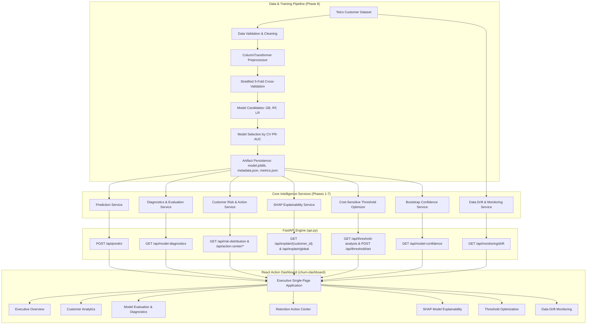

# Customer Retention Intelligence — Production ML & Decision Platform

[](https://www.python.org/)
[](https://fastapi.tiangolo.com/)
[](https://react.dev/)
[](https://scikit-learn.org/)
[](https://shap.readthedocs.io/)
[]()

An enterprise-grade customer churn intelligence platform combining **SQL, Python, scikit-learn, SHAP, FastAPI, and React (Vite & Tailwind CSS)** to identify high-risk customer segments, perform cost-sensitive threshold optimization, explain model decisions with Shapley values, monitor inference data drift, and power proactive customer retention campaigns.

---

## Table of Contents

- [Platform Architecture](#platform-architecture)
- [Roadmap Capabilities Summary (Phases 1–9)](#roadmap-capabilities-summary-phases-19)
- [Modular ML Pipeline & Persistence](#modular-ml-pipeline--persistence)
- [Model Diagnostics & Evaluation Methodology](#model-diagnostics--evaluation-methodology)
- [SHAP Model Explainability](#shap-model-explainability)
- [Cost-Sensitive Threshold Optimization](#cost-sensitive-threshold-optimization)
- [Statistical Confidence & Uncertainty](#statistical-confidence--uncertainty)
- [Data Drift & Prediction Monitoring](#data-drift--prediction-monitoring)
- [Complete API Specification](#complete-api-specification)
- [Interactive Retention Dashboard](#interactive-retention-dashboard)
- [Repository Structure](#repository-structure)
- [Getting Started & Installation](#getting-started--installation)
- [Testing & Verification](#testing--verification)
- [Analytical Assumptions & Limitations](#analytical-assumptions--limitations)

---

## Platform Architecture



---

## Roadmap Capabilities Summary (Phases 1–9)

| Phase | Milestone | Core Capabilities | Primary Artifacts / APIs |
|:---:|---|---|---|
| **Phase 1** | **Model Persistence & Inference Pipeline** | Production artifact directory, Joblib serialization, schema validation, fallback logic, real-time inference. | `artifacts/models/churn_model/`, `POST /api/predict` |
| **Phase 2** | **Model Evaluation & Diagnostics** | Confusion matrix at configurable thresholds, ROC-AUC, PR curve, Lift and Gain charts over customer deciles. | `evaluation_service.py`, `GET /api/model-diagnostics` |
| **Phase 3** | **Customer Risk Segmentation & Action Center** | High/Medium/Low risk categorization, customer ranking by churn probability, revenue at risk calculation, CSV export. | `risk_service.py`, `GET /api/risk-distribution`, `GET /api/action-center/*` |
| **Phase 4** | **SHAP Model Explainability** | SHAP TreeExplainer, global mean absolute SHAP feature attributions, individual customer risk vs. protective waterfalls. | `explainability_service.py`, `GET /api/explain/global`, `GET /api/explain/{customer_id}` |
| **Phase 5** | **Cost-Sensitive Threshold Optimization** | Business loss matrix evaluation, optimal threshold discovery (Min-Cost, Max-F1, Budgeted Recall), live threshold persistence. | `threshold_optimizer.py`, `GET /api/threshold-analysis`, `POST /api/threshold/set` |
| **Phase 6** | **Statistical Confidence & Model Uncertainty** | Non-parametric bootstrap resampling (500 iterations), 95% confidence intervals across ROC-AUC, PR-AUC, F1, Precision, and Recall. | `confidence_service.py`, `GET /api/model-confidence` |
| **Phase 7** | **Data Drift & Prediction Monitoring** | Baseline reference profiling, Population Stability Index (PSI), Kolmogorov-Smirnov (KS) test, prediction distribution shift alerts. | `monitoring_service.py`, `artifacts/monitoring/`, `GET /api/monitoring/drift` |
| **Phase 8** | **Modular Pipeline Refactoring** | Clean architectural separation (`backend/app/ml/`), centralized dataclass configuration, reproducible training orchestrator. | `backend/app/config.py`, `backend/app/ml/pipeline.py` |
| **Phase 9** | **Integration, QA & Documentation** | Cross-phase end-to-end integration test suite, 7 dedicated dashboard navigation views, full production verification. | `tests/test_phase9_integration.py`, `churn-dashboard/` |

---

## Modular ML Pipeline & Persistence

The ML system is refactored into a modular architecture under `backend/app/ml/`:
```text
backend/app/
├── config.py                 # Centralized configuration dataclasses
└── ml/
    ├── data/
    │   ├── validation.py     # Schema enforcement and sanitization
    │   └── preprocessing.py  # ColumnTransformer with OHE & scaling
    ├── models/
    │   ├── train.py          # Candidate model factory & hyperparameter configs
    │   ├── evaluate.py       # Cross-validation & test metrics computation
    │   ├── persistence.py    # Joblib pipeline serialization
    │   └── predict.py        # Validated single & batch inference
    └── pipeline.py           # Unified ChurnTrainingPipeline orchestrator
```

### Artifact Structure
Persisted models are saved under versioned directories in `artifacts/models/churn_model/`:
- `model.joblib`: Serialized scikit-learn `Pipeline` (including fitted `ColumnTransformer` and classifier).
- `metadata.json`: Feature requirements, target labels, operating threshold, risk category cutoffs, and timestamp.
- `metrics.json`: Test set evaluation metrics, cross-validation summaries, and feature importances.

To retrain the complete pipeline from scratch:
```bash
python -m backend.app.ml.pipeline
```

---

## Model Diagnostics & Evaluation Methodology

Basic accuracy can be misleading in churn prediction due to class imbalance (~26.5% churn prevalence). The platform calculates comprehensive diagnostic curves across decision thresholds:

1. **Confusion Matrix**: Dynamically calculated for any threshold $t \in [0, 1]$:
   $$\text{Predicted Positive} \iff \hat{P}(\text{Churn}) \ge t$$
2. **ROC Curve & ROC-AUC**: Evaluates discrimination ability across all thresholds (Gradient Boosting achieves $\text{ROC-AUC} \approx 0.847$).
3. **Precision-Recall Curve & PR-AUC**: Focuses on the positive churn class against the majority-class baseline.
4. **Decile Lift & Cumulative Gain**:
   - Customers are ranked in descending order of predicted churn probability and divided into 10 deciles.
   - **Lift**: Ratio of decile churn rate to overall population churn rate. Top deciles achieve $> 2.8\times$ lift over baseline.
   - **Cumulative Gain**: Percentage of total churners captured within the top $k$ deciles (top 30% of accounts capture ~70% of all churners).

---

## SHAP Model Explainability

The platform integrates **SHAP (SHapley Additive exPlanations)** to provide transparent, mathematically rigorous explanations:

- **Global Feature Importance**: Evaluates mean absolute SHAP values across the entire customer cohort:
  $$I_j = \frac{1}{N} \sum_{i=1}^N |\phi_j^{(i)}|$$
  Identifies month-to-month contracts, tenure, fiber optic internet, and electronic check payment as primary drivers.
- **Local Customer Attribution (Waterfall)**: Decomposes any individual customer's prediction starting from the base rate ($E[f(x)]$) to the final predicted log-odds:
  $$f(x) = \phi_0 + \sum_{j=1}^M \phi_j$$
  - **Risk Factors ($\phi_j > 0$)**: Attributes pushing the customer towards churning (e.g., month-to-month contract, zero tenure, electronic check).
  - **Protective Factors ($\phi_j < 0$)**: Attributes anchoring the customer to remain active (e.g., two-year contract, high tenure, tech support).

---

## Cost-Sensitive Threshold Optimization

Rather than using an arbitrary threshold of 0.50, the platform evaluates the economic impact of classification errors using an explicit cost matrix:

$$\text{Total Cost} = C_{\text{FP}} \cdot \text{FP} + C_{\text{FN}} \cdot \text{FN} + C_{\text{intervention}} \cdot (\text{TP} + \text{FP})$$

Where:
- $C_{\text{FN}}$: Cost of a missed churner (unretained customer lifetime value).
- $C_{\text{FP}}$: Cost of contacting an active customer who was not at risk.
- $C_{\text{intervention}}$: Operational outreach or incentive cost.

### Optimization Objectives
The service automatically evaluates thresholds $t \in [0.05, 0.95]$ in 0.01 increments and discovers:
1. **Minimum Cost Threshold**: Minimizes expected economic loss.
2. **Maximum F1 Threshold**: Balances precision and recall.
3. **Budget-Constrained Recall**: Maximizes churners caught under an intervention budget ceiling.
4. **Target-Recall Precision**: Maximizes precision while guaranteeing a minimum recall requirement.

Operating thresholds can be dynamically persisted via `POST /api/threshold/set` and immediately govern all live inference.

---

## Statistical Confidence & Uncertainty

To ensure model evaluations reflect statistical rigor rather than single-sample chance, the platform implements non-parametric bootstrap resampling:
- Resamples the held-out test partition with replacement $B = 500$ times.
- Calculates point estimates and empirical percentile 95% confidence intervals:
  $$\text{CI}_{95\%} = \left[ q_{0.025}^*, \, q_{0.975}^* \right]$$
- Metrics reported with 95% CIs: ROC-AUC, PR-AUC, F1-Score, Precision, Recall, and Accuracy.
- Supports head-to-head model comparison $\Delta = M_A - M_B$ with bootstrap hypothesis testing.

---

## Data Drift & Prediction Monitoring

Production ML systems degrade as customer distributions shift. The platform monitors data integrity and feature distributions against a saved reference baseline (`artifacts/monitoring/reference_profile.json`):

### 1. Population Stability Index (PSI)
Quantifies distribution shift across numerical and categorical features:
$$\text{PSI} = \sum_{k=1}^K (P_k - Q_k) \cdot \ln\left(\frac{P_k}{Q_k}\right)$$
- **PSI $< 0.10$**: No Significant Drift (Model stable)
- **$0.10 \le \text{PSI} \le 0.20$**: Moderate Drift (Monitoring advised)
- **PSI $> 0.20$**: Significant Drift (Action required / Retraining recommended)

### 2. Kolmogorov-Smirnov (KS) Test
Performs a two-sample non-parametric test comparing cumulative empirical distribution functions of continuous features (`tenure`, `MonthlyCharges`, `TotalCharges`).

### 3. Prediction Distribution Shift
Tracks changes in model output probabilities and percentage of accounts flagged as high-risk.

---

## Complete API Specification

All endpoints are hosted on `http://localhost:8000` (interactive documentation available at `http://localhost:8000/docs`).

### 1. Real-Time Inference
- **`POST /api/predict`**
  - **Request Body**:
    ```json
    {
      "gender": "Female",
      "SeniorCitizen": 0,
      "Partner": "Yes",
      "Dependents": "No",
      "tenure": 12,
      "PhoneService": "Yes",
      "MultipleLines": "No",
      "InternetService": "Fiber optic",
      "OnlineSecurity": "No",
      "OnlineBackup": "No",
      "DeviceProtection": "No",
      "TechSupport": "No",
      "StreamingTV": "Yes",
      "StreamingMovies": "No",
      "Contract": "Month-to-month",
      "PaperlessBilling": "Yes",
      "PaymentMethod": "Electronic check",
      "MonthlyCharges": 85.50,
      "TotalCharges": 1026.00
    }
    ```
  - **Response (200 OK)**:
    ```json
    {
      "churn_probability": 0.74,
      "predicted_churn": true,
      "risk_category": "High",
      "threshold": 0.22,
      "model_name": "gradient_boosting"
    }
    ```

### 2. Model Diagnostics
- **`GET /api/model-diagnostics?threshold=0.35`**
  - Returns `confusion_matrix`, `classification_report`, `roc_curve` (points & AUC), `pr_curve` (points & AP), and `lift_chart` (10 deciles with cumulative gain).

### 3. Retention Action Center
- **`GET /api/risk-distribution`**: High, medium, and low risk population counts and percentages.
- **`GET /api/action-center/summary`**: High-risk customer count, average churn probability, and monthly revenue at risk.
- **`GET /api/action-center/customers?risk_category=High&contract=Month-to-month&limit=25`**: Paginated list of prioritized customers.
- **`GET /api/action-center/export-csv?risk_category=High`**: Direct CSV download of prioritized retention targets.

### 4. SHAP Explainability
- **`GET /api/explain/global`**: Top global feature importances by mean absolute SHAP value.
- **`GET /api/explain/{customer_id}`**: Local SHAP decomposition, base value, and ranked risk vs. protective drivers.

### 5. Threshold Optimization
- **`GET /api/threshold-analysis?missed_churner_cost=5&false_positive_cost=1&intervention_cost=10`**: Evaluates threshold curve and optimal operating points.
- **`POST /api/threshold/set`**:
  ```json
  { "threshold": 0.28 }
  ```
  Persists operating threshold to `artifacts/models/churn_model/metadata.json`.

### 6. Statistical Confidence
- **`GET /api/model-confidence?n_bootstraps=500&confidence_level=0.95`**: Point estimates and 95% confidence intervals for all evaluation metrics.

### 7. Monitoring & Drift
- **`GET /api/monitoring/drift`**: Full drift report with overall health status, feature-level PSI/KS statistics, and prediction drift metrics.

---

## Interactive Retention Dashboard

The React frontend (`churn-dashboard`) provides a single-pane executive experience with 7 specialized views:

1. **Executive Overview**: High-level portfolio KPIs, tenure cohort curves, contract mix, and key churn drivers.
2. **Customer Analytics**: Multi-segment filtering (Contract, Tenure, Payment, Risk) and cohort comparisons.
3. **Model Evaluation & Diagnostics**: Interactive threshold slider, confusion matrix, ROC/PR curves, decile lift/gain charts, and 95% bootstrap confidence intervals.
4. **Retention Action Center**: Real-time revenue at risk KPI cards, risk distribution pills, customer prioritization table with search/filters, and one-click CSV export.
5. **SHAP Model Explainability**: Global feature importance horizontal bar chart, customer search with waterfall factor breakdown, and live `/api/predict` sandbox simulator.
6. **Threshold Optimization**: Cost curve visualization, 4 optimal operating recommendations (Min Cost, Max F1, Budget, Target Recall), and one-click threshold persistence button.
7. **Model Monitoring**: Overall system drift badge (Green/Yellow/Red), feature PSI & Kolmogorov-Smirnov metrics table, and probability distribution shift tracking.

---

## Repository Structure

```text
Customer-Retention_Intelligence/
├── api.py                                 # FastAPI application exposing all endpoints
├── requirements.txt                       # Locked dependencies (scikit-learn, shap, fastapi, etc.)
├── artifacts/
│   ├── models/
│   │   └── churn_model/                   # Versioned production model artifacts
│   │       ├── model.joblib
│   │       ├── metadata.json
│   │       └── metrics.json
│   └── monitoring/
│       └── reference_profile.json         # Baseline feature statistics for drift detection
├── backend/
│   └── app/
│       ├── config.py                      # Centralized configuration dataclasses
│       └── ml/                            # Phase 8 modular ML pipeline
│           ├── data/                      # Validation, cleaning, and preprocessing
│           ├── models/                    # Training, evaluation, persistence, prediction
│           └── pipeline.py                # Unified pipeline runner
├── churn_project/
│   ├── data/
│   │   └── telco_churn.csv                # Validated dataset snapshot
│   ├── python/                            # Core service modules (Phases 1-7)
│   │   ├── persistence.py                 # Phase 1 Model artifact persistence
│   │   ├── prediction_service.py          # Phase 1 Inference & validation
│   │   ├── evaluation_service.py          # Phase 2 Evaluation & diagnostics
│   │   ├── risk_service.py                # Phase 3 Risk segmentation & action center
│   │   ├── explainability_service.py      # Phase 4 SHAP tree explainability
│   │   ├── threshold_optimizer.py         # Phase 5 Cost-sensitive optimization
│   │   ├── confidence_service.py          # Phase 6 Bootstrap statistical confidence
│   │   └── monitoring_service.py          # Phase 7 Data drift & prediction monitoring
│   └── sql/
│       └── churn_analysis.sql             # SQL BI reporting queries
├── churn-dashboard/                       # React 18 + Vite + Tailwind CSS frontend
│   ├── package.json
│   ├── vite.config.js
│   └── src/
│       ├── App.jsx                        # Main navigation & view router
│       └── components/                    # View components
│           ├── ModelEvaluationView.jsx
│           ├── ActionCenterView.jsx
│           ├── ExplainabilityView.jsx
│           ├── ThresholdOptimizationView.jsx
│           └── MonitoringView.jsx
├── scripts/
│   └── test_all.py                        # Full end-to-end test execution script
└── tests/                                 # 67 automated test cases
    ├── test_analysis.py                   # Data validation & SQL tests
    ├── test_phase1_persistence_and_prediction.py
    ├── test_phase2_model_evaluation.py
    ├── test_phase3_risk_segmentation.py
    ├── test_phase4_shap_explainability.py
    ├── test_phase5_threshold_optimization.py
    ├── test_phase6_statistical_confidence.py
    ├── test_phase7_drift_monitoring.py
    ├── test_phase8_modular_pipeline.py
    └── test_phase9_integration.py         # End-to-end integration tests
```

---

## Getting Started & Installation

### Prerequisites
- Python 3.11, 3.12, 3.13, or 3.14
- Node.js 20+ or 22+ & npm
- Git

### 1. Clone & Setup Python Environment

```powershell
# Clone repository
git clone <repository-url>
cd Customer-Retention_Intelligence

# Create and activate virtual environment
python -m venv .venv
.\.venv\Scripts\Activate.ps1

# Install locked dependencies
python -m pip install --upgrade pip
python -m pip install -r requirements.txt
```

### 2. Start the Backend API

```powershell
python api.py
```
The FastAPI application starts on `http://localhost:8000`.

### 3. Start the Frontend Dashboard

In a separate terminal:
```powershell
cd churn-dashboard
npm install
npm run dev
```
Open `http://localhost:5173` to explore the dashboard.

---

## Testing & Verification

The project is backed by **67 automated Python tests** and complete frontend tests/builds:

```powershell
# Run all Python and frontend checks in one command:
python scripts/test_all.py
```

### Individual Check Commands:
```powershell
# Run the 67 Python unit & integration tests:
python -m pytest tests/ -v

# Run the Phase 9 End-to-End integration test suite specifically:
python -m pytest tests/test_phase9_integration.py -v

# Run frontend ESLint, Vite production build, and Node utility tests:
npm test --prefix churn-dashboard
```

---

## Analytical Assumptions & Limitations

1. **Static Snapshot Data**: The dataset contains point-in-time subscriber records without event timestamps; churn rates represent cross-sectional associations rather than time-series hazard rates.
2. **Correlation vs. Causation**: Feature importance scores and SHAP attributions describe predictive association; they do not prove that altering an attribute (e.g. switching payment method) will causally prevent churn.
3. **Illustrative Cost Parameters**: Cost optimization parameters ($C_{\text{FN}} = \$5$, $C_{\text{FP}} = \$1$, $C_{\text{intervention}} = \$10$) are default operational models; teams must configure parameters according to true enterprise unit economics.
4. **Controlled Experimentation**: Model predictions should be used to target prospective retention cohorts, followed by randomized A/B holdout groups to quantify true incremental campaign lift.
