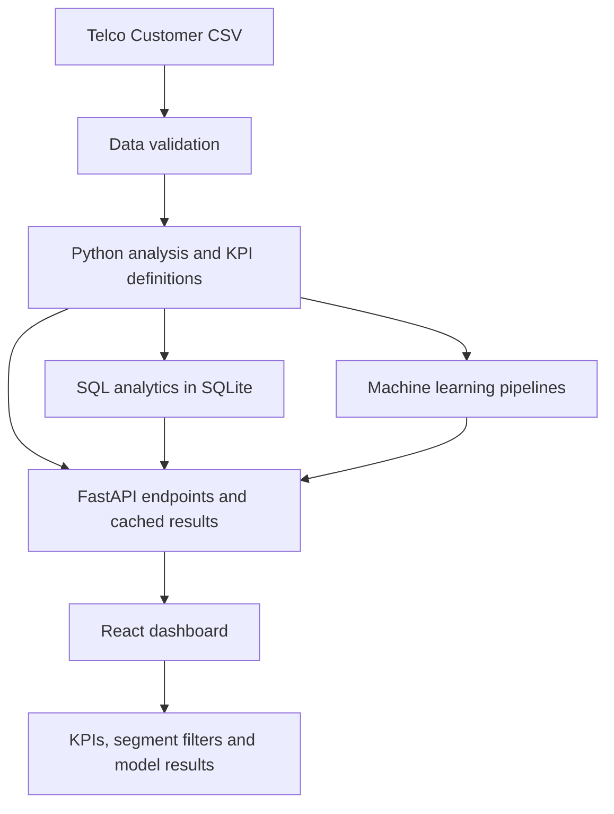

# Telecom Customer Churn & Retention Intelligence

An end-to-end customer churn analytics project combining **SQL, Python, scikit-learn, FastAPI, and React** to analyze customer attrition, identify high-risk segments, evaluate churn prediction models, and support data-driven retention decisions.

The project integrates data validation, business KPI analysis, SQL reporting, machine learning, and an interactive dashboard into a reproducible analytics workflow.

> **Data scope:** The supplied Telco Customer Churn dataset is a static customer snapshot without event dates. All reported churn rates and segment comparisons describe this snapshot; they are not monthly time trends.

## Table of Contents

- [Project Overview](#project-overview)
- [Business Objectives](#business-objectives)
- [Key Findings](#key-findings)
- [Technology Stack](#technology-stack)
- [Architecture](#architecture)
- [Repository Structure](#repository-structure)
- [Getting Started](#getting-started)
- [Running the Analysis](#running-the-analysis)
- [Dashboard and API](#dashboard-and-api)
- [Data Validation](#data-validation)
- [SQL Analytics](#sql-analytics)
- [Machine Learning Methodology](#machine-learning-methodology)
- [KPI Definitions](#kpi-definitions)
- [Testing and Reproducibility](#testing-and-reproducibility)
- [Limitations](#limitations)
- [Future Improvements](#future-improvements)

## Project Overview

Customer churn affects recurring revenue, customer lifetime value, and the efficiency of retention campaigns. This project explores customer behavior in the supplied telecom dataset and translates the analysis into actionable business questions.

The application combines four analytical layers:

1. **Data quality and exploratory analysis:** Validate customer records and investigate churn patterns.
2. **SQL business intelligence:** Calculate customer, revenue, contract, payment, and tenure metrics.
3. **Machine learning:** Compare classification models and evaluate their ability to identify customers who churn.
4. **Interactive analytics dashboard:** Present KPIs, segment comparisons, and model results through a React interface backed by FastAPI.

The emphasis is on reproducible calculations, interpretable results, and transparent business assumptions—not just model accuracy.

## Business Objectives

- Quantify observed customer churn and active customer counts.
- Identify customer segments with comparatively high churn rates.
- Examine relationships between churn, tenure, contract type, payment method, and customer characteristics.
- Measure historical churned monthly charges and active monthly revenue exposure without conflating them with recoverable revenue.
- Compare classification models using metrics appropriate for an imbalanced churn dataset.
- Translate analytical findings into retention hypotheses that can be tested.

## Key Findings

The following results were recalculated from the checked-in dataset on **20 October 2026**.

| Metric | Result |
|---|---:|
| Customers | 7,043 |
| Dataset columns | 21 |
| Observed churn | 1,869 customers |
| Overall churn rate | 26.54% |
| Active customers | 5,174 |
| Active monthly revenue exposure | $316,985.75 |
| Historical churned monthly charges | $139,130.85 |

### Observed churn patterns

| Segment | Observed churn rate |
|---|---:|
| Customers with 0–12 months of tenure | 47.4% |
| Customers with 49+ months of tenure | 9.5% |
| Electronic-check customers | 45.3% |
| Automatic credit-card customers | 15.2% |

These differences identify segments worth investigating. They do not establish that tenure, payment method, or any other individual characteristic causes churn.

### Machine-learning results

Gradient Boosting was selected using five-fold cross-validation PR-AUC on the training partition.

| Evaluation metric | Result |
|---|---:|
| Held-out test precision (churn) | 42.9% |
| Held-out test recall (churn) | 92.7% |
| Held-out test F1-score (churn) | 58.7% |
| Held-out test PR-AUC | 65.4% |
| Baseline accuracy (most frequent class) | 73.5% |
| Baseline PR-AUC (test-set churn prevalence) | 26.5% |
| Selected model cross-validation PR-AUC | 0.671 ± 0.035 |
| Held-out test ROC-AUC | 0.847 |
| Selected decision threshold | 0.12 |

The held-out test set contains 1,761 customers, including 467 churners. Precision, recall, and F1 use a threshold selected on a separate validation subset from the training data.

The selected threshold prioritizes identifying churners under illustrative relative costs. Its practical usefulness depends on contact capacity, intervention effectiveness, and actual business costs.

**Dashboard interpretation:** At the selected threshold, the model catches 92.7% of churners in the held-out sample (recall), while 42.9% of customers it flags are churners (precision). The 58.7% F1-score summarizes that precision-recall trade-off. Its 65.4% PR-AUC is above the 26.5% test-set churn-prevalence baseline. The 73.5% majority-class baseline accuracy is less informative on its own: always predicting “active” can look accurate while missing every churner. Retention teams should weigh the model's high recall against the outreach volume, contact capacity, intervention effectiveness, and actual business costs before using predictions to prioritize outreach.

## Technology Stack

| Layer | Technologies |
|---|---|
| Data analysis | Python, pandas, NumPy |
| Statistical and ML modeling | scikit-learn |
| Business intelligence | SQL, SQLite |
| Backend API | FastAPI |
| Frontend | React, Vite, JavaScript |
| Data visualization | Dashboard charts and analytical summaries |
| Testing | pytest, Node.js test runner, ESLint |
| Build tooling | npm, Vite |

## Architecture



### Data flow

1. Load and validate the customer dataset.
2. Calculate shared business KPIs and customer-segment metrics.
3. Execute SQL analysis against a SQLite table named `telco_churn`.
4. Train and evaluate classification pipelines using training, validation, and held-out test partitions.
5. Expose analytical results through FastAPI.
6. Display metrics and segment results in the React dashboard.

Dataset and analysis results are cached within the running API process. The current application does not persist a trained model artifact.

## Repository Structure

```text
.
├── api.py
├── requirements.txt
├── scripts/
│   └── test_all.py
├── tests/
│   └── test_analysis.py
├── churn_project/
│   ├── data/
│   │   └── telco_churn.csv
│   ├── python/
│   │   └── churn_analysis.py
│   ├── sql/
│   │   └── churn_analysis.sql
│   └── outputs/
│       └── sql_results.txt
└── churn-dashboard/
    ├── package.json
    ├── package-lock.json
    └── src/
```

The frontend directory contains the React application and its Vite configuration. Generated files such as `dist/` and `node_modules/` should not be committed.

## Getting Started

### Prerequisites

- Python 3.11–3.14
- Node.js 20.19+ or 22.12+
- npm
- Git

Use a Python version compatible with the pinned dependencies in `requirements.txt`.

### 1. Clone the repository

```bash
git clone <your-repository-url>
cd <repository-directory>
```

Replace the placeholders with your actual Git repository URL and directory.

### 2. Install Python dependencies

Create and activate a virtual environment.

**Windows PowerShell**

```powershell
python -m venv .venv
.\.venv\Scripts\Activate.ps1
python -m pip install --upgrade pip
python -m pip install -r requirements.txt
```

**Linux or macOS**

```bash
python3 -m venv .venv
source .venv/bin/activate
python -m pip install --upgrade pip
python -m pip install -r requirements.txt
```

### 3. Start the API

From the repository root:

```bash
python api.py
```

The API uses port 8000 by default, unless overridden with the `PORT` environment variable.

### 4. Start the React dashboard

Open a second terminal:

```bash
cd churn-dashboard
npm ci
npm run dev
```

Open the local URL printed by Vite in your terminal.

The dataset is expected at:

```text
churn_project/data/telco_churn.csv
```

The loader resolves this location relative to the repository root. No environment variables are required for the default local setup.

## Running the Analysis

### Run the standalone Python analysis

From the repository root:

```bash
python churn_project/python/churn_analysis.py
```

This runs the standalone analysis and generates its supported outputs.

### Execute the SQL analytics

The SQL queries expect a SQLite table named `telco_churn` with the dataset's validated columns.

Load the dataset into SQLite before executing:

```text
churn_project/sql/churn_analysis.sql
```

The checked-in `churn_project/outputs/sql_results.txt` provides a reference for the verified KPI results.

### Run the automated test suite

From the repository root:

```bash
python scripts/test_all.py
```

The combined suite runs the Python/SQL tests, followed by frontend lint, production build, and Node.js utility tests.

For backend-only checks:

```bash
python -m pytest
```

## Dashboard and API

The FastAPI backend exposes the following endpoints.

| Endpoint | Purpose |
|---|---|
| `/health` | Health check |
| `/ready` | Readiness check |
| `/api/key-metrics` | Core customer and revenue KPIs |
| `/api/contract-analysis` | Churn analysis by contract |
| `/api/payment-analysis` | Churn analysis by payment method |
| `/api/tenure-analysis` | Churn analysis by tenure |
| `/api/segments` | Filtered customer-segment metrics |
| `/api/ml-models` | Model evaluation results |
| `/api/full-analysis` | Combined analytical results |

The `/api/segments` endpoint supports contract, tenure-group, payment-method, heuristic-segment, and churn filters.

The API validates requests and caches dataset and analysis results per process. Restarting the API clears in-memory caches. Model evaluation may require training on the first request that needs ML results.

For interactive API documentation, open `/docs` on the running FastAPI server.

## Data Validation

The data-loading and validation pipeline checks:

- Required columns and expected dataset structure.
- Empty or duplicate customer IDs.
- Expected categories and target labels.
- Presence of both churn classes.
- Numeric validity and nonnegative charges.
- Tenure bounds and binary senior-citizen values.
- Missing `TotalCharges` values.

A blank `TotalCharges` is treated as zero only for customers with zero tenure. Unexpected categories fail validation with a readable error rather than silently entering the analysis.

These checks help maintain consistent results across the Python analysis, SQL queries, API, and dashboard.

## SQL Analytics

The SQL analysis examines:

- Overall churn and active customer counts.
- Contract-level churn patterns.
- Payment-method comparisons.
- Tenure-based segmentation.
- Rule-based customer risk-score groups.
- Historical churned monthly charges.
- Active monthly revenue exposure.

The queries use shared population definitions and consistent KPI formulas. Empty denominators return zero.

Segment totals can overlap and must not be summed without accounting for the overlap.

The rule-based risk score is a manually weighted heuristic used for triage and descriptive analysis. It is separate from the machine-learning model's predicted churn probability.

## Machine Learning Methodology

### Models evaluated

- Logistic Regression
- Random Forest
- Gradient Boosting

### Preprocessing and validation

The evaluation uses a scikit-learn `ColumnTransformer` and `Pipeline` to keep preprocessing inside model training.

- Nominal categorical features use one-hot encoding.
- Missing-value handling and numerical scaling are fitted within the pipeline.
- A stratified 25% test set is held out for final evaluation.
- Five-fold stratified cross-validation runs on the training partition.
- Gradient Boosting is selected using training cross-validation PR-AUC.
- A separate validation subset from the training data is used to choose the classification threshold.

The test set is evaluated once after model selection and threshold selection.

### Evaluation metrics

- **Precision:** Proportion of customers flagged as churners who actually churned in the test sample.
- **Recall:** Proportion of actual test-set churners identified by the model.
- **F1-score:** Harmonic mean of precision and recall.
- **ROC-AUC:** Ability to rank churners above non-churners across classification thresholds.
- **PR-AUC:** Precision-recall performance, particularly useful when the positive class is less frequent.

The reported threshold of `0.12` uses illustrative relative costs of five units for a missed churner and one unit for outreach to a non-churner.

These units are assumptions for evaluation, not measured financial values. Replace them with actual operational costs before making retention decisions.

Feature importance and model associations do not establish causation. No trained model artifact is currently persisted, and model results are cached only for the lifetime of the running API process.

## KPI Definitions

| KPI | Definition |
|---|---|
| Churn rate | Customers with `Churn = Yes` divided by all valid customers in the supplied snapshot. |
| Active customers | Customers with `Churn = No`. |
| Historical churned monthly revenue | Sum of `MonthlyCharges` for customers already marked `Churn = Yes`. |
| Active monthly revenue at risk | Sum of `MonthlyCharges` for customers marked `Churn = No`; descriptive exposure, not expected loss. |
| Revenue loss share | Historical churned monthly revenue divided by total `MonthlyCharges` across all customers. |

Counts and rates use the same validated population in Python, SQL, and the API. Dollar values use two decimal places in SQL and Python; dashboard currency formatting preserves the calculated amount.

Historical churned charges are not recoverable revenue. Active monthly revenue exposure is not a prediction of future losses. Estimating either expected loss or recoverable revenue requires additional assumptions or intervention evidence.

## Testing and Reproducibility

The project includes automated checks for:

- Dataset validation.
- KPI calculation and SQL/Python consistency.
- ML preprocessing and reproducibility.
- API responses and error handling.
- Frontend segment-filter utilities.
- API error-message handling.
- Frontend lint and production build.

The reported model results use a deterministic random state of 42. Model metrics describe one held-out sample and are not guarantees of future performance.

For a reliable reproduction, use the checked-in dataset, install the documented dependencies, and run the complete test suite before changing analytical logic.

## Limitations

1. **Static snapshot:** The dataset contains no event timestamps, so it cannot establish monthly churn trends or customer-level churn trajectories.
2. **Observational comparisons:** Differences between customer segments do not establish causal effects.
3. **Illustrative intervention economics:** The threshold cost ratio is hypothetical and must be replaced with actual retention costs and benefits.
4. **No campaign outcomes:** The dataset does not identify customers contacted, offers accepted, or customers retained because of an intervention.
5. **Model uncertainty:** Reported performance comes from one held-out sample; additional validation is needed before operational use.
6. **No persisted model artifact:** The current API caches evaluation results in memory rather than loading a saved model for production inference.
7. **Overlapping segments:** Segment revenue and customer totals may overlap and should not be added without adjusting for that overlap.

## Future Improvements

- Add route-level lazy loading and optimize the frontend's initial JavaScript bundle.
- Audit and update vulnerable npm dependencies using compatible fixes.
- Persist the selected model and preprocessing pipeline for repeatable inference.
- Add confidence intervals and additional evaluation across samples or time-based data when available.
- Develop retention experiments to measure incremental intervention impact.
- Incorporate dated customer history to support time-based churn analysis.
- Add campaign costs, offer response, and retention outcomes to estimate economic value.
- Improve automated integration testing across the API and React dashboard.
- Add verified dashboard screenshots and a concise executive summary.

## Project Goal

This project demonstrates an end-to-end analytics workflow that connects validated data, SQL reporting, Python analysis, machine-learning evaluation, and an interactive web application.

Its central goal is to turn customer churn data into **reproducible business insights and testable retention hypotheses**, while making analytical assumptions, model limitations, and financial interpretations explicit.
